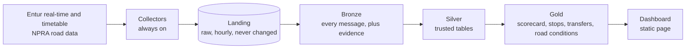
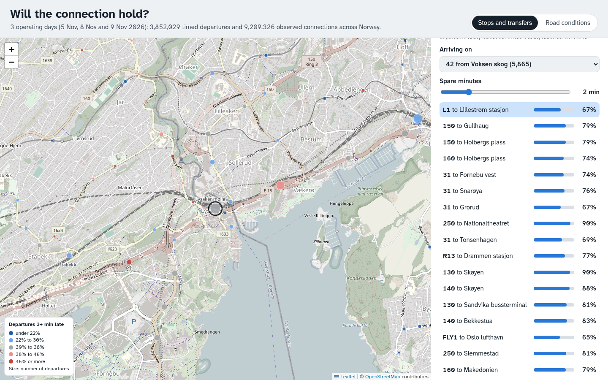

# DAT535 Group 21: public transport reliability

Which Norwegian buses, trains and ferries run late or get cancelled, and why?

We collect Entur's real-time transport feeds and Statens vegvesen's road data around the
clock, because neither source keeps the raw history. A Spark pipeline on one small VM then
turns the raw messages into trusted tables, layer by layer: Bronze, Silver, Gold.



A weekday brings about 4.8 million SIRI ET messages, plus about 620,000 vehicle position
messages. For operating day 2026-10-29, Silver read three days of ET and reduced the 280 million
stop-call versions for that day to 1.87 million stop calls, one row per journey at each stop.

This is a course project for DAT535 at the University of Stavanger. The assignment and
grading basis is [`PROJECT.md`](PROJECT.md).

## What is built

| Part | What it does | Runs | Code |
| ---- | ------------ | ---- | ---- |
| Collection | Stores every message unchanged in hourly files | always on, first feed since 2026-10-15 | [`collector/`](collector/) |
| Bronze | Loads each message as one Parquet row, with evidence of where it came from | every night | [`bronze.py`](pipeline/bronze.py), [`bronze_datex.py`](pipeline/bronze_datex.py) |
| Silver | Builds trusted tables with a stated grain, keys and quality flags | every night | [`silver.py`](pipeline/silver.py), [`silver_datex.py`](pipeline/silver_datex.py) |
| Gold | Per day: line scorecard, late departures per stop and hour, observed transfer chances, late departures under road conditions | by hand | [`gold.py`](pipeline/gold.py) |
| Dashboard | Map of stops, transfer explorer and road-conditions view over chosen Gold days | by hand | [`dashboard/`](dashboard/) |
| Monitoring | Status page, push alerts, Prometheus and Grafana | always on | [`monitor.py`](collector/monitor.py) |

Gold has been run by hand for 2026-11-05, 08 and 09, the days with both Entur and road Silver.
With 2 spare minutes a connection held 77 % of the time nationally. Departures near congested
roads were late 10 percentage points more often than near free-flowing ones in the same mode and
hour. The main Gold product we planned, predicting whether a departure will be on time, is not
built. [`docs/pipeline/gold.md`](docs/pipeline/gold.md) describes it.



*The dashboard's transfer explorer at Lysaker: how often each connection from bus 42 held.*

## Where to read

Start with the [system overview](docs/report/overview.md). It walks through the whole system
in one file, with the code that matters. Every section there links to the detail below.

| To understand | Read |
| ------------- | ---- |
| How the components connect | [architecture](docs/system/architecture.md) |
| The VM's disk and memory limits | [storage](docs/system/storage.md) |
| Why each layer is built the way it is | [methodology](docs/pipeline/methodology.md) |
| The Silver tables and their rules | [silver](docs/pipeline/silver.md) |
| What Gold builds and the products we planned | [what is built](docs/pipeline/gold-example.md), [gold use cases](docs/pipeline/gold.md) |
| Entur's data | [sources](docs/entur/sources.md), [real-time feeds](docs/entur/realtime.md), [identifiers](docs/entur/identifiers.md) |
| The road data (DATEX) | [sources](docs/datex/sources.md), [content](docs/datex/content.md) |
| Other sources we considered | [external sources](docs/external/sources.md) |
| What went wrong and what we learned | [problem log](docs/report/problems.md) |
| The run records behind our numbers | [evidence](docs/report/evidence/) |
| How to operate the VM | [collector runbook](collector/README.md) |

## Repository

| Path | Contents |
| ---- | -------- |
| [`collector/`](collector/) | The always-on collectors, monitor, metrics exporter and systemd units |
| [`pipeline/`](pipeline/) | The Bronze, Silver and Gold Spark jobs and their tests |
| [`dashboard/`](dashboard/) | The static Gold dashboard and the script that packages it |
| [`.github/workflows/`](.github/workflows/) | `dat535-dev.yml` tests and runs a one-hour sample. `dat535-prod.yml` deploys and runs the nightly pipeline |
| [`docs/`](docs/) | Everything in the table above |
| [`notebooks/`](notebooks/) | Exploration |
| [`entur-ai-docs/`](entur-ai-docs/) | Entur's generated BigQuery catalog, kept as reference |
| [`labs/`](labs/) | Course lab material |

## Tests

```sh
# Collectors. Localhost only, and pinned to the VM's websockets version.
uv run --python 3.11 --with-requirements requirements-dev.txt --with websockets==10.4 \
  python -m unittest discover -s collector/tests

# Pipeline. Needs Java 8 or 17, and no external services. PyArrow and pandas are not in
# requirements-dev.txt yet, and one test expects the VM's UTC clock.
TZ=UTC uv run --python 3.11 --with-requirements requirements-dev.txt --with pyarrow --with pandas \
  python -m unittest discover -s pipeline/tests
```

Both suites run on the VM on every push to a branch other than `main`, and again before every
deploy from `main`.

## Data credits

Contains data under the Norwegian Licence for Open Government Data (NLOD) made available by
Entur AS, and by the Norwegian Public Roads Administration (Statens vegvesen).
