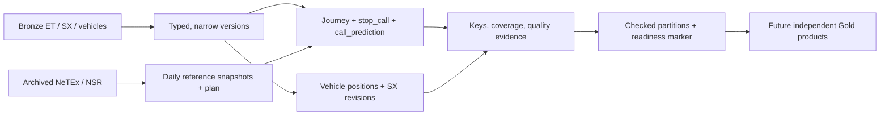

# Entur Silver — design and implementation log

**Scope:** reusable Entur facts and references. No Gold product, model, on-time threshold,
DATEX transformation or spatial mapping is implemented. Full contracts and operations:
[silver.md](silver.md).

## Shape of the layer



## Decisions that matter

| Decision | Evidence / reason | Implementation |
| -------- | ----------------- | -------------- |
| Call key = operating day + journey + **order** | A journey can visit the same quay twice; positions and ET share these references. | `CALL_KEY`; dated-ID mapping before dedup |
| Preserve the planned denominator | An absent report proves neither punctuality nor cancellation. | Full outer plan/RT join; three coverage states |
| Latest actual-bearing call wins; journey status is separate | Replays must not replace an actual with an estimate; cancellation messages can contain no calls. | `latest`, `build_journeys`, `build_calls` |
| Predictions have a separate grain | Final outcomes cannot describe what was known before departure. | Event × planned/actual reference × fixed lead time |
| Namespace vehicle IDs; retain unassigned positions | IDs are not promised national uniqueness; two captured reports had no operating date. | Codespace + vehicle + update time; observation-day partition |
| Keep SX content revisions when native version is absent | Captured RUT SX messages omit `Version`; using version 0 would merge distinct messages. | Native version or canonical content hash; nested scopes and validity periods |
| Resolve references before emitting journeys | FLT places journeys before patterns; FIN repeats assignment IDs across day types. | Two-pass line parser; assignment relation includes its selectors |
| Respect fixed/flexible calendar scopes and time windows | Some SKY flexible filenames look ordinary; VIL/VYX also reference the other shared calendar. | XML structure selects scope; fallback evaluates its whole rule in that scope; windows stay windows |
| Use archived snapshots and native reference versions | Future exports erase historical plan; operators can repeat at older versions in flexible files. | Archive ≤ operating day; highest numeric version; conflicting ties fail |
| Expose useful join fields, defer product choices | DATEX uses WGS84 station points but different road geometry projections; road weather poorly covers ferries. | NSR coordinates/hubs, journey/call IDs, typed times and mode; no speculative nearest-station assignment |
| Bound memory and protect the root disk | VM has 8 GB RAM and a 38 GB root disk; earlier Bronze sorts filled `/tmp`. | Parse/project before shuffles; disk stages; narrow broadcasts; scratch on `/data`; shared lock |

## Four code paths to know

**1. Final state** — ordering is explicit, with receiver time and hash breaking producer-time ties.
[`latest`](../../pipeline/silver.py)

```python
order = [has_actual.desc(), recorded_at.desc_nulls_last(),
         received_at.desc_nulls_last(), payload_sha256.desc_nulls_last()]
# row_number over the operating-day + journey + call-order key; keep rank 1.
```

**2. The denominator** — deduplicate each side first, then keep their union.
[`merge_plan`](../../pipeline/silver.py)

```python
rt.withColumn("has_realtime", lit(True)).join(planned, CALL_KEY, "full")
# has_plan / has_realtime → matched, no_realtime, realtime_only.
# Actuals remain null for a planned call that was never reported.
```

**3. What was known** — interval selection avoids a version × cutoff expansion;
stale producer replays cannot undo a newer state already seen.
[`build_predictions`](../../pipeline/silver.py)

```python
available_at = greatest(recorded_at, received_at)
next_available_at = lead(available_at).over(call_window)
# available_at <= cutoff < next_available_at (or no next version).
# Sample the journey cancellation interval independently at the same cutoff.
```

**4. Quality and publication** — failed rules stay countable; publication follows validation.
[`issues`, `stage_table`, `publish`](../../pipeline/silver.py)

```python
df = issues(df, ("unknown_quay", quay_id.isNotNull() & known_quay.isNull()))
# Staged Parquet → non-null/unique key checks → counts by issue → install.
# Publish latest.json last; rollback restores the previous day on install failure.
```

## Validation evidence — 2026-10-28

Real inputs were copied read-only from the **2026-10-26** collector archives, never fetched
again from Entur: 8 actual ET messages, 108 SX envelopes, 10 vehicle envelopes, and the
**complete national NeTEx and NSR archives**. The saved [run evidence](../report/evidence/silver-2026-10-26-sample.json)
includes archive hashes, source counts, quality reasons and output sizes.

| Check | Observed |
| ----- | -------- |
| NSR keys / coordinates | 101,843 quays; 58,018 stop places; unique IDs; no coordinate issues |
| National plan | 76,186 journeys; 1,855,992 calls; 4,751 lines; 273 operators; 21,086 dated aliases |
| Sample plan/ET join | 232 reported calls matched; 1,855,760 planned calls had no report in this small RT sample |
| Reference gaps | 1,879 calls retained with missing quay-mapping flags |
| Prediction sampling | 598 rows across both events/references and the five lead times |
| Vehicle reconnect dedup | 197 versions → 196 reports; 13 rows flagged; 2 missing operating dates retained |
| SX revisions | 50 situation versions → 47 distinct revisions; languages/scopes retained |
| Source envelope contracts | No errors in the captured sample |
| Completeness marker | `partial`, `ready=false`, as required for bounded RT input |
| Local run time | 299.807 s; Spark 3.5.0, Python 3.11, Java 8, two workers, 2 GiB driver heap |
| Offline regressions | 45 pipeline tests (27 Silver); 54 collector tests with the VM's websockets 10.4 |
| Workflow checks | Both YAML files parsed; 14 shell steps passed `bash -n` |
| Default Spark session | Four workers, supplied scratch directory, 32 shuffle partitions, zstd, batch 256 and UTC verified |

These numbers are parsing/join evidence, **not** national punctuality or coverage rates.
Offline fixtures also cover repeated quays, overnight calls, DST ambiguity, cancellation-only
journeys, late producer/receiver times, stale replays, missing identities, reference version
conflicts, preserving a missing reported quay during plan enrichment, replacement reruns and
rollback after a failed partition install.

## Review regressions — 2026-10-28

| Boundary | Corrected behavior | Regression evidence |
| -------- | ------------------ | ------------------- |
| Complete hours, unusable content | Bronze contract failures and invalid vehicle objects block strict publication; exploratory output stays partial. | 120 unusable envelopes, all hours present: strict failure preserves the old marker; partial output retains every quarantine row and reason. |
| Normal and dated IDs together | Look up the explicit dated alias before falling back to the journey ID; retain source IDs and flag conflicts. | Vehicle date resolves from its alias; ET alias fallback still works; unknown aliases leave the date null. |
| Journey cancellation without call data | Preserve planned cutoff targets so cancellation can independently qualify them, with journey provenance and quality flags. | No preceding call and first call after cutoff both produce a cancellation sample; cancellation received after cutoff does not. |
| GraphQL transport errors | Classify error frames before accessing their array payload as a data object. | Error arrays quarantine with their locator; unexpected payload/data shapes also quarantine instead of raising `AttributeError`. |

The regression tests distinguish source contract failures from field-level quality flags;
quarantining a missing call order alone still allows a complete, otherwise valid input run.

## Code map and remaining limits

| File | Responsibility |
| ---- | -------------- |
| [`silver_parse.py`](../../pipeline/silver_parse.py) | Pure SIRI/GraphQL decoders and explicit schemas |
| [`silver_reference.py`](../../pipeline/silver_reference.py) | Streaming zip reader, scoped calendars, dated aliases, local timetable clocks, NSR |
| [`silver.py`](../../pipeline/silver.py) | Spark joins/windows, predictions, quality ledger, CLI, staged publication |
| [`test_silver.py`](../../pipeline/tests/test_silver.py) | Offline source fixtures, Spark semantics, reruns and rollback |

Production full-day ET runtime, shuffle spill and final row distributions still need a VM
run; a bounded real-time sample cannot establish them. The 32 initial shuffle partitions are
a starting setting, not a measured optimum. The three-UTC-day ET window bounds late-update
recovery. Reference download time and unverified vehicle speed units remain explicit, rather
than being silently assumed. BigQuery comparison still requires the team's GCP project.

Calendar interpretation follows Entur's [Calendar profile](https://entur.atlassian.net/wiki/spaces/PUBLIC/pages/728825959/Calendar)
and [timetable profile](https://entur.atlassian.net/wiki/spaces/PUBLIC/pages/728760393), checked
against the archived XML. Existing investigation results remain in [silver.md](silver.md).
