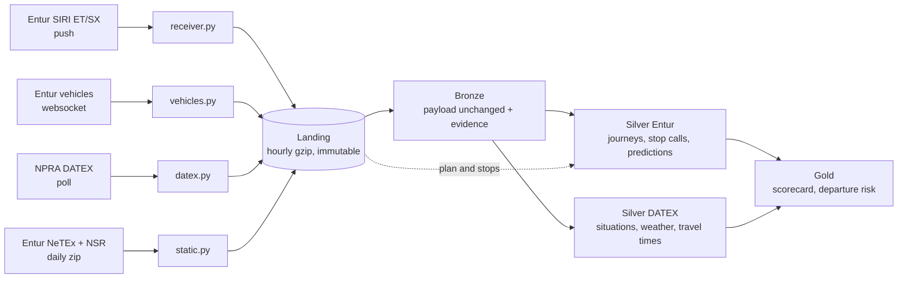

# System overview

The system in one file: what each core component does, why it is built that way, the code that
matters, and the numbers behind it. Meant to be read on its own and lifted into the report and the
presentation. Snippets are real code, shortened only where marked with `...`.

**Keep it current:** when a core component is added or changes, change it here in the same PR.
`problems.md` is the raw log of what went wrong; this is the picture of what exists.

## The project in one paragraph

We collect Norwegian public transport data around the clock, because nobody keeps the raw history:
Entur's real-time feeds (where every bus, train and ferry is, and when it is expected), the
timetable, and the road authority's road works, accidents and road weather. A Spark pipeline on one
small VM turns this into trusted tables (Medallion: Bronze → Silver → Gold). The main question
it answers for a traveller: *will my departure be on time?*



### Words you need

| Word | Meaning |
| ---- | ------- |
| SIRI ET | real-time times per journey: aimed, expected, actual. The main feed |
| SIRI SX | disruption messages written for passengers |
| NeTEx, NSR | the timetable, and the register of stops and their coordinates |
| DATEX | the road authority's (NPRA) format for road events, weather and travel times |
| Quay | one platform or stop position. A stop place has several |
| Operating day | the day a journey belongs to. A night bus at 00:30 belongs to yesterday |
| Stop call | one journey at one stop position on one operating day. Our finest grain |
| Grain | what one row of a table means. Every table states it |

### The numbers

| | |
| - | - |
| Machine | one VM: 4 vCPU, 7.9 GB RAM, 984 GB data disk, Spark 3.5 in local mode |
| Collected per weekday | 8.9 GB SIRI ET, 1.3 GB vehicles, 0.8 GB DATEX, 0.3 GB timetable and stops (gzip) |
| Scale of ET | 4.8 M messages a day, 160 GB of XML text, about 280 M call versions |
| Plan | 76,000 journeys and 1.86 M stop calls a day, 101,000 quays |
| Reduction | 280 M call versions become 1.87 M stop calls |

## 1. Collection: nobody keeps the raw history

**In one sentence:** small always-on Python services write every message, unchanged, to one gzip
file per hour; nothing else may ever touch those files.

| Service | Source | How | Volume |
| ------- | ------ | --- | ------ |
| `collector/receiver.py` | SIRI ET, SX | Entur pushes to us over a reverse SSH tunnel | 4.8 M messages a day |
| `collector/vehicles.py` | vehicle positions | GraphQL websocket subscription | 620,000 messages a day |
| `collector/datex.py` | NPRA DATEX | polls five feeds, every 2.5 min to 6 h | 8.2 GB downloaded a day |
| `collector/static.py` | NeTEx, NSR | one zip each per day, daily timer | 330 MB a day |

Why hourly files: a day of raw text is too big for one file and a line every message is too small;
an hour is the unit we can close, compress, count and rerun. A running hour is `*.part` and readers
never touch it.

All three streaming collectors share one writer. A closed hour is never reopened:

```python
# collector/hourly.py
def finalize(part):
    """hour=HH.jsonl.part -> hour=HH.jsonl.gz. Never overwrites a closed file."""
    base = part.with_name(part.name[: -len(".part")])
    final = base.with_name(base.name + ".gz")
    ...
    tmp = final.with_name(final.name + ".tmp")
    with open(part, "rb") as src, open(tmp, "wb") as raw:
        with gzip.GzipFile(filename="", mode="wb", fileobj=raw, mtime=0) as gz:
            shutil.copyfileobj(src, gz, 1 << 20)
        raw.flush()
        os.fsync(raw.fileno())
    os.rename(tmp, final)
```

`gz` then `rename` means a reader sees the whole file or none of it. A landing line is our own small
envelope around the untouched payload:

```json
{"received_at": "2026-11-05T08:00:00.153Z", "endpoint": "vehicles", "payload": "<raw XML or JSON>"}
```

**Why it matters:** Entur's timetable export keeps at most 48 h of past days, and no raw SIRI
archive exists anywhere. A day we fail to collect is gone. Everything downstream can be rebuilt from
landing.

Monitoring is a small script every 2 minutes: are the services alive, are the files growing, is
disk fine. It writes a status page and sends a push on change. Reruns and disk cleanup stay manual
(section 6).

## 2. Bronze: load first, interpret later

**In one sentence:** every landing line becomes one Parquet row with the payload unchanged, plus
evidence of where it came from; a line that can't be read is kept and labelled, never dropped.

```python
# pipeline/bronze.py, ingest_feed
schema = StructType([
    StructField("received_at", StringType()),
    StructField("endpoint", StringType()),
    StructField("payload", StringType()),
    StructField("_bronze_raw_line", StringType()),
])
raw = spark.read \
    .schema(schema) \
    .option("mode", "PERMISSIVE") \
    .option("columnNameOfCorruptRecord", "_bronze_raw_line") \
    .option("encoding", "UTF-8") \
    .option("maxStringLen", MAX_STRING_LEN) \
    .json([str(f) for f in files])

status = when(col("_bronze_raw_line").isNotNull(), "corrupt") \
    .when(col("received_at").isNull() | col("payload").isNull(), "incomplete") \
    .when(col("endpoint") != feed, "wrong_endpoint") \
    .otherwise("ok")
```

Each row also gets the source file, hour, payload SHA-256 and size, status, and run id. Each run
writes a JSON record: files, rows, bad rows, missing and open hours.

| Decision | Evidence |
| -------- | -------- |
| zstd, not Snappy | one ET hour: 1,621 MB Snappy, 558 MB zstd, same write time |
| Reader batch of 256, not 4096 | the default killed a 3 GB driver on 4 × 4096 rows of up to 16M characters; 256 read the hour in 23 s |
| `maxStringLen` lifted | ET pushes reach 22.8M characters, DATEX snapshots 28.6M; Jackson's default of 20M marked them corrupt |
| Write the day's folder, no `partitionBy` | `partitionBy` on a constant still sorts the whole day; it filled the root disk |
| DATEX: `parquet.page.size.row.check.min` = 1 | Parquet measures its buffer only after 100 rows; every row is 26.6M characters, and the first full day ran out of heap |

**Is it sound?** Audited 2026-11-06: Bronze rows equal landing lines on every feed checked, and the only
collection dip is 2026-10-21, 15-17 UTC. SIRI for 2026-10-23 was never ingested; one manual rerun
restored it from landing (2026-11-06, prod run 78: 4,808,892 ET, 4,605 SX and 643,233 vehicle rows,
equal to the landing lines). Vehicle positions reach Bronze from 2026-10-26, plus that 2026-10-23;
landing has them from 2026-10-17.

DATEX has its own Bronze job, `pipeline/bronze_datex.py`, because one row is one poll and failed polls
are evidence: a run reports polls by outcome, distinct snapshots and the longest gap.

## 3. Silver for Entur: where trust is built

**In one sentence:** turn every version of every message into one trusted row per stop call, without
losing what was planned but never reported, and without letting future knowledge leak into the
past.

| Table | One row is | Key |
| ----- | ---------- | --- |
| `stop_call` | final state of one journey at one stop position, or a planned call never reported | operating date, journey, order |
| `journey` | final state of one journey on one day | operating date, journey |
| `call_prediction` | what was known of a call at 1, 5, 10, 20, 30 min before it | call, event, reference, lead |
| `vehicle_position` | one position report | codespace, vehicle, time |
| `sx_situation` | one revision of a disruption message | participant, situation, revision |
| `quay`, `stop_place`, `line`, `operator`, `dated_journey` | one entity in that day's plan or stop archive | id |
| `quarantine` | a message or version with no usable identity | source locator |

### Decode each day once, keep only what changed

ET restates a whole journey on every change, so most rows say nothing new. Measured on one hour:
**98 % of `RecordedCall`s, 54 % of all call versions and 96 % of journey versions repeat the previous
one.** An operating day needs three UTC days of messages, so decoding per operating day would parse
everything three times. Instead each UTC day is decoded once into `silver/_decoded/`, and a state is
emitted only when it differs from that entity's last one:

```python
# pipeline/silver_parse.py, parse_et
for call_index, call in enumerate(calls):
    raw_order = call.findtext("Order")
    state = hash((call.tag, tuple((child.tag, child.text) for child in call)))
    actuals = (1 if call.find("ActualArrivalTime") is not None else 0) + (2 if call.find("ActualDepartureTime") is not None else 0)
    if not says_something_new(last, (op, jid, raw_order), state, recorded, actuals):
        continue
    ...
```

Dropping a repeat loses (almost) nothing: a state holds until the next one, and the first copy has the
earliest time. Two things make that true, both found by comparing with the slow version key by key
(`problems.md`, 2026-11-06): the memory keeps the newest copy it dropped, so a late replay of older
data still loses to it, and it starts over wherever a task's input breaks, because Spark packs
pieces of several hours into one task, largest first. What is left is measured: memory does not
cross a task boundary, so a replay right after one can still count: on 2026-10-29, 2 of 33.0 M
predictions moved by 3 s and 100 got a later `available_at` (seconds). Rows leave Python through Arrow
(`mapInArrow`) instead of being pickled one by one.

### Every version gets an operating day

The key is `operating date + journey + order`. Most messages name their day, but VY trains, Bane NOR
trains and extra journeys don't. Resolving them in order, and saying how:

```python
# pipeline/silver.py, normalize_journeys
joined = joined.withColumn("date_source", F.when(F.col("operating_date").isNotNull(), "framed")
                           .when(F.col("_mapped_date").isNotNull(), "alias").otherwise(F.col("derived_date_source"))) \
    .withColumn("operating_date", F.coalesce("operating_date", "_mapped_date", "derived_operating_date")) \
    .drop("derived_operating_date", "derived_date_source")
```

`framed` is the message itself, `alias` the plan's dated journey, then a date inside the id
(`VYG:DatedServiceJourney:1614_DAL-DRM_26-11-05`), then the Oslo date of the first aimed time. The two
guesses are flagged. Before this, 4.4 M rows a day sat in quarantine as "unknown identity", 83 % of
them simply trains of another day, and real extra journeys never reached the tables.

### The final state of a call

An actual time beats any estimate, then the producer's time decides, then ours. Same input, same
winner, on every rerun:

```python
# pipeline/silver.py
def latest(df, key, actual_first=False):
    """Deterministic winner; producer time beats arrival order. No payload shuffle."""
    from pyspark.sql import Window
    F = functions()
    order = []
    if actual_first:
        order.append((F.col("actual_arrival_at").isNotNull() | F.col("actual_departure_at").isNotNull()).desc())
    if "recorded_at" in df.columns:
        order.append(F.col("recorded_at").desc_nulls_last())
    order += [F.col("received_at").desc_nulls_last(), F.col("payload_sha256").desc_nulls_last(),
              F.col("entity_index").desc_nulls_last()]
    return df.withColumn("_rank", F.row_number().over(Window.partitionBy(*key).orderBy(*order))) \
        .filter(F.col("_rank") == 1).drop("_rank")
```

### The denominator: planned but never reported

A journey that never reports is neither on time nor cancelled. A full outer join at the same grain
keeps both sides and says which is which:

```python
# pipeline/silver.py, merge_plan
merged = rt.withColumn("has_realtime", F.lit(True)).join(planned, key, "full")
...
.withColumn("realtime_status", F.when(~F.col("has_realtime"), "no_realtime")
            .when(~F.col("has_plan"), "realtime_only").otherwise("matched"))
```

2026-10-29: 1,802,968 calls matched, 52,423 planned but unreported, 14,308 reported but not planned.
Without NeTEx the unreported ones are invisible, which biases punctuality per operator by up to 8 %.

### What was known, when

For prediction, a final state is the answer, not an input. `call_prediction` samples what was
available at fixed times before each call. A version counts only after both the producer's and our
own timestamp, and a late replay of old data can't undo newer knowledge:

```python
# pipeline/silver.py, asof_intervals
df = df.filter(F.col("recorded_at").isNotNull() & F.col("received_at").isNotNull()) \
    .withColumn("available_at", F.greatest("recorded_at", "received_at"))
...
knowledge = Window.partitionBy(*key).orderBy("available_at")
seen = knowledge.rowsBetween(Window.unboundedPreceding, Window.currentRow)
df = df.withColumn("_best_seen", F.max("_priority").over(seen)) \
    .filter(F.col("_priority") == F.col("_best_seen")).drop("_priority", "_best_seen")
return df.withColumn("next_available_at", F.lead("available_at").over(knowledge))
```

A join on `available_at <= cutoff < next_available_at` then avoids a versions × cutoffs explosion.

### Flag, don't delete; publish last

A failed rule adds a name to the row's `dq_issue` array; the row stays countable:

```python
# pipeline/silver.py
def issues(df, *rules):
    """Add named facts about invalid values. Keep the row and all its reasons."""
    F = functions()
    additions = [F.when(condition, F.lit(name)) for name, condition in rules]
    return df.withColumn("dq_issue", F.sort_array(F.array_distinct(F.concat(
        F.coalesce(F.col("dq_issue"), empty_issues()),
        F.filter(F.array(*additions).cast("array<string>"), lambda x: x.isNotNull())
    ))))
```

Every table is written to a staging folder, its key checked for uniqueness, its issues counted, and
only then moved into place. `latest.json` is written last: `status=complete, ready=true` is what Gold
checks, and a failed run leaves the previous day published.

**Example of what the flags catch:** one ferry journey with all 8 calls stamped 9 h before departure
(`implausible_departure_delay`). `actual_departure_equals_aimed` shows where an operator copies the
aimed time into the actual one, which would hide delay.

## 4. Silver for DATEX: the road, joined by place and time

**In one sentence:** typed tables of road situations, weather and travel times, plus links from each
quay to what is nearby, so that Gold never has to parse a road format.

| Table | One row is | Key |
| ----- | ---------- | --- |
| `road_situation` | one version of a situation record seen that day | record, version, version time |
| `road_situation_interval` | one span in which it applies | + start |
| `road_weather` | one station at one measurement time | site, time |
| `road_travel_time` | one road section and 5-minute period | section, period |
| `weather_site`, `road_section` | a station or section, and how it behaved that day | id |
| `quay_road_situation`, `quay_road_section` | something within 500 m of a quay | both ids |
| `quay_weather_site` | a quay's nearest working station | quay |

### What the data taught us

All feeds cover all 24 hours, but what they contain is not evenly spread, and that is the source's
nature rather than a fault in our collection (measured on all polls of 2026-11-05):

- **Road events cluster in working hours.** 8-11 new record versions an hour at night, 49-76 from 08
  to 16 local: operators register road works during the day.
- **Most road works are not always on.** 42 % of records apply in recurring windows, such as
  20:00-06:00 Monday to Thursday, inside dates that span months.
- **Travel time has real holes.** A section has a value for 26-43 % of periods at night and 60-65 % by
  day: no value means no vehicles were measured. 55 of 202 sections reported nothing all day.
- **Some stations are dead or broken.** 19 stations never updated, one still lists a measurement 1.6
  years old; others report -39.9 °C or a constant 80.3 mm/h of rain.

### Applying a road event only when it applies

Treating `overallStartTime..overallEndTime` as continuous would put night works in the morning rush,
so each record is expanded into the spans that apply on that day. Applicable days without a time of
day mean the whole local day:

```python
# pipeline/silver_datex_parse.py, active_intervals
time_from, time_to = period["time_from"] or "00:00:00", period["time_to"] or "00:00:00"
for offset in (-1, 0, 1):
    local_day = day + timedelta(days=offset)
    if period["days"] and WEEKDAYS[local_day.weekday()] not in period["days"]:
        continue
    begin = datetime.combine(local_day, wall_clock(time_from), OSLO)
    finish = datetime.combine(local_day, wall_clock(time_to), OSLO)
    if finish <= begin:
        finish = datetime.combine(local_day + timedelta(days=1), wall_clock(time_to), OSLO)
    spans.append((max(low, begin.astimezone(timezone.utc)), min(high, finish.astimezone(timezone.utc))))
```

### Joining by place without comparing everything

There is no id to join a quay to a road event. Comparing 100,000 quays with 100,000 road points is 10
billion distances, so both sides get a grid cell, and only neighbouring cells are compared:

```python
# pipeline/silver_datex.py, near
around = F.array(F.lit(-1), F.lit(0), F.lit(1))
q = quays.withColumn("_d_lat", F.explode(around)).withColumn("_d_lon", F.explode(around)) \
    .withColumn("_cell_lat", F.floor(F.col("quay_latitude") / 0.01) + F.col("_d_lat")) \
    .withColumn("_cell_lon", F.floor(F.col("quay_longitude") / 0.02) + F.col("_d_lon")).drop("_d_lat", "_d_lon")
p = points.withColumn("_cell_lat", F.floor(F.col("latitude") / 0.01)).withColumn("_cell_lon", F.floor(F.col("longitude") / 0.02))
joined = q.join(p, ["_cell_lat", "_cell_lon"]).withColumn(
    "distance_m", haversine_m(F.col("quay_latitude"), F.col("quay_longitude"), F.col("latitude"), F.col("longitude")))
return joined.filter(F.col("distance_m") <= radius_m).groupBy("quay_id", *key).agg(F.round(F.min("distance_m"), 1).alias("distance_m"))
```

Road geometry comes in UTM 33 (metres) and is projected to latitude and longitude in about ten lines
(`utm33_to_wgs84`), checked against `pyproj` to the centimetre.

**Cost:** a full day takes 116 s and turns 500 MB of Bronze into about 7 MB of tables.

## 5. Gold: answering a question

**In one sentence:** Gold serves one named consumer per table and never parses raw data.

Built so far, the **daily line scorecard** (`pipeline/gold_scorecard.py`): one row per line per day.
Journeys and stop calls are counted separately and then joined, so a journey with 30 stops still counts
as one journey. A missing report stays unknown, and a line with nothing to measure gets a blank, not 0 %.

```python
# pipeline/gold_scorecard.py, build_scorecard
scored = reported & ~cancelled & F.coalesce(F.col("for_boarding"), F.lit(True)) & \
    F.col("actual_departure_at").isNotNull() & F.col("aimed_departure_at").isNotNull() & \
    delay.isNotNull() & ~F.isnan(delay) & \
    ~F.array_contains("dq_issue", "departure_before_arrival") & \
    ~F.array_contains("dq_issue", "implausible_departure_delay")
```

2026-10-29: 3,992 lines; 1,618,184 scored departures; 35.5 % at least 3 minutes late. That looked high,
so we checked it: the delay histogram is one smooth curve around +1 min, lateness grows along the
route (10 % at the first stop, 47 % after stop 16) and peaks at 15-16 local, and the independent `delay`
field of vehicle positions agrees per operator (ATB 31 % vs 35 %, Brakar 34 % vs 36 %).

The main product, **departure risk**, comes after Silver has proven itself: see
[pipeline/gold.md](../pipeline/gold.md). A first test, an ablation of the Silver sources on that
question, is kept off `main` (branch `experiments/silver-ablation`): Entur's history and estimate
carry the signal; DATEX and SX alerts change its AUC by at most 0.0005.

## 6. Running it

| Thing | How |
| ----- | --- |
| Collectors, monitor, archive | systemd user services on the VM, deployed by the prod workflow |
| Bronze, Silver | GitHub Actions on a self-hosted runner: nightly on `main`, one job at a time |
| One Spark job at a time | every step runs under `flock /data/dat535/.spark.lock`; two 4 GB drivers don't fit in 8 GB |
| Environments | `dat535-dev.yml` writes to `/data/dat535/dev`, `dat535-prod.yml` to `/data/dat535/prod`, deploys need manual approval |
| A failed day | rerun by hand: `gh workflow run dat535-prod.yml --ref main -f bronze_date=YYYY-MM-DD` (or `silver_date`) |
| Disk | delete by hand, cheapest loss first: [system/storage.md](../system/storage.md) |
| Status | status page, Grafana, push notification on any failure |

Deliberately manual: reruns and disk cleanup. Less code to run, and less to explain.

## 7. Decisions worth defending

| Decision | Why | What it costs |
| -------- | --- | ------------- |
| Collect raw ourselves | no raw archive exists; BigQuery has only Entur's processed ET | a VM running non-stop |
| Keep landing and Bronze unchanged | every later bug can be fixed by rerunning | disk: 19.5 GB a weekday before cleanup |
| Stop call as the grain, not the message | the finest grain people still understand | version history needs its own table |
| Flag, never delete | quality must be measurable | consumers must read the flags |
| Python's XML parser in Spark tasks, not `spark-xml` | no extra dependency; one decoder used everywhere | 37 min per UTC day |
| One VM, one Spark job at a time | what we have | a long job blocks the next: a 4-hour run cost a Bronze day (`problems.md`) |
| Time-split validation, as-of features | neighbouring departures leak, and final states are the future | less training data |
