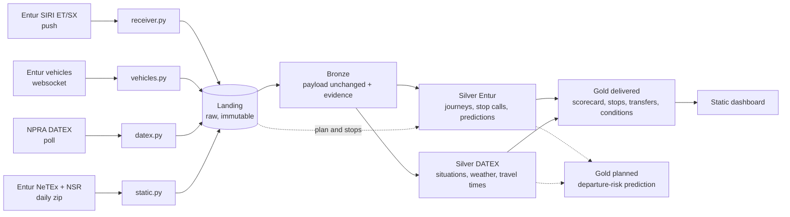
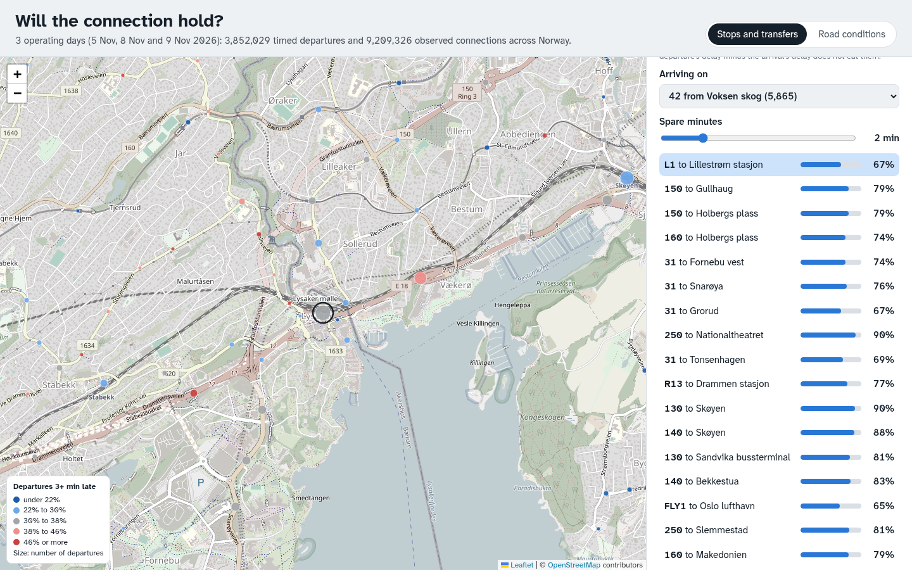

# System overview

A guided tour with code and evidence for the report and presentation.
Delivered Gold describes past days: a line scorecard, a stop map, observed transfer chances and
late departures under road conditions, shown in a static dashboard. Departure-risk prediction is planned.

Up: [README](../../README.md) · Related: [evidence](evidence/README.md), [problem log](problems.md)

**Keep it current:** update this file in the same PR as any core component change.
Snippets omit code only where marked with `...`.

## The project in one paragraph

Collectors preserve Entur's transport feeds, timetable and stops, plus NPRA's road data.
Spark builds Bronze, Silver and Gold on one VM. Gold describes past performance.



### Words you need

| Word | Meaning |
| ---- | ------- |
| SIRI ET | Aimed, expected and actual times per journey, our main feed |
| SIRI SX | Disruption messages for passengers |
| NeTEx, NSR | Timetable and stop register |
| DATEX | NPRA's format for road events, weather and travel times |
| Quay | One platform or stop position within a stop place |
| Operating day | The day a journey belongs to, which can precede its UTC observation day |
| Stop call | One journey at one stop position on one operating day |
| Grain | What one row represents |

A 00:30 night bus can belong to the previous operating day.

### The numbers

These are scale estimates. Some original collection measurements are undated.
The reduction is consistent with the archived complete-day
[2026-10-29 run](evidence/silver-2026-10-29.json), not a daily guarantee.

| Measure | Value |
| ------- | ----- |
| Machine | One VM, 4 vCPU, 7.9 GB RAM, 984 GB data disk, Spark 3.5.0 in local mode |
| Collected per weekday | 8.9 GB SIRI ET, 1.3 GB vehicles, 0.8 GB DATEX, 0.3 GB timetable and stops |
| Scale of ET | 4.8 M messages a day, 160 GB of XML text, about 280 M call versions |
| Plan | 76,000 journeys and 1.86 M stop calls a day, 101,000 quays |
| Reduction | 280 M call versions become 1.87 M stop calls |

Collection sizes are compressed landing data, with gzip for messages and ZIP for static archives.
[Storage](../system/storage.md#what-a-day-costs) owns capacity figures and their measurement dates.

## 1. Collection: nobody keeps the raw history

Collectors keep payloads unchanged in hourly gzip files or daily static zips.

| Service | Source and transport | Volume |
| ------- | -------------------- | ------ |
| [`receiver.py`](../../collector/receiver.py) | SIRI ET/SX pushes through a reverse SSH tunnel | 4.8 M messages/day |
| [`vehicles.py`](../../collector/vehicles.py) | GraphQL websocket | 620,000 messages/day |
| [`datex.py`](../../collector/datex.py) | Five NPRA feeds, polled every 2.5 min to 6 h | Situations alone download 8.2 GB/day |
| [`static.py`](../../collector/static.py) | NeTEx and NSR, one zip each per day | 330 MB/day |

Hourly files give a bounded unit to close, compress, count and rerun.
Readers skip open `*.part` files. The streaming collectors share
[`hourly.py`](../../collector/hourly.py), which never reopens a closed hour.

```python
# collector/hourly.py
def finalize(part):
    """hour=HH.jsonl.part -> hour=HH.jsonl.gz. Never overwrites a closed file."""
    base = part.with_name(part.name[: -len(".part")])
    final = base.with_name(base.name + ".gz")
    ...
    tmp = final.with_name(final.name + ".tmp")
    with open(part, "rb") as src, open(tmp, "wb") as raw:
        with gzip.GzipFile(filename="", mode="wb", fileobj=raw, mtime=0) as gz:
            shutil.copyfileobj(src, gz, 1 << 20)
        raw.flush()
        os.fsync(raw.fileno())
    os.rename(tmp, final)
    ...
```

Atomic rename exposes the complete compressed file. Each line wraps the untouched payload.

```json
{"received_at": "2026-11-05T08:00:00.153Z", "endpoint": "vehicles", "payload": "<raw XML or JSON>"}
```

Entur retains at most 48 h of past timetable days. Its documented historical ET source is
processed BigQuery data, without a raw SIRI archive. Landing can rebuild downstream tables,
but the sources cannot reconstruct a missed day of raw message history.

More: [landing contract](../system/architecture.md#landing-zone),
[Entur sources](../entur/sources.md#why-archive-timetables-and-stops),
[DATEX sources](../datex/sources.md#feeds), [collector code](../../collector/).

## 2. Bronze: load first, interpret later

[`bronze.py`](../../pipeline/bronze.py) keeps one landing line per Parquet row.
Unreadable lines remain labelled evidence.

```python
# pipeline/bronze.py, ingest_feed
schema = StructType([
    StructField("received_at", StringType()),
    StructField("endpoint", StringType()),
    StructField("payload", StringType()),
    StructField("_bronze_raw_line", StringType()),
])
raw = spark.read \
    .schema(schema) \
    .option("mode", "PERMISSIVE") \
    .option("columnNameOfCorruptRecord", "_bronze_raw_line") \
    .option("encoding", "UTF-8") \
    .option("maxStringLen", MAX_STRING_LEN) \
    .json([str(f) for f in files])

status = when(col("_bronze_raw_line").isNotNull(), "corrupt") \
    .when(col("received_at").isNull() | col("payload").isNull(), "incomplete") \
    .when(col("endpoint") != feed, "wrong_endpoint") \
    .otherwise("ok")
```

Rows add source file, hour, payload SHA-256 and size, status and run ID.
Run records count files, rows, errors and hour coverage.

| Decision | Evidence |
| -------- | -------- |
| zstd over Snappy | 2026-10-22 08 UTC input wrote 1,621 MB Snappy or 558 MB zstd in 126 s or 129 s |
| Reader batch 256 | 2026-10-24 test killed a 3 GB driver at 4096. Batch 256 read the hour in 23 s |
| Lift `maxStringLen` | ET reaches 22.8M characters and DATEX 28.6M. Jackson's 20M default marked them corrupt |
| Write the day directly | `partitionBy` on a constant sorted the whole day and filled the root disk on 2026-10-24 |
| DATEX `parquet.page.size.row.check.min=1` | First full-day write buffered 26.6M-character snapshots until heap exhaustion on 2026-10-29 |

A check on 2026-11-06 matched Bronze rows to landing lines on every checked feed.
The only collection dip it found was 2026-10-21, 15–17 UTC.
Prod run 78 restored 2026-10-23 Bronze, with 4,808,892 ET, 4,605 SX and 643,233 vehicle rows.

At that check, other vehicle Bronze began 2026-10-26, against landing from 2026-10-17.
On 2026-11-11, vehicle Bronze date folders spanned 2026-10-23 to 2026-11-09. These are different snapshots of coverage, not contradictory start dates.

[`bronze_datex.py`](../../pipeline/bronze_datex.py) also counts poll outcomes, distinct snapshots
and the longest successful-poll gap.

More: [Bronze methodology](../pipeline/methodology.md#bronze-load-first-interpret-later),
[storage](../system/storage.md#what-a-day-costs),
[Bronze code](../../pipeline/bronze.py), [DATEX Bronze](../../pipeline/bronze_datex.py).

## 3. Silver for Entur: where trust is built

Silver keeps unreported planned calls, final reported states and past knowledge.
Keys below are within date partitions. Calls, journeys and references use operating dates.
Vehicles and SX use UTC observation dates.

| Table | One row is | Key |
| ----- | ---------- | --- |
| `stop_call` | Final reported call or unreported planned call | `journey_id, call_order` |
| `journey` | Final journey state, including plan-only journeys | `journey_id` |
| `call_prediction` | Call state at a fixed arrival/departure cutoff | Call key, `event, reference, lead_minutes` |
| `vehicle_position` | One position report | `codespace, vehicle_id, last_updated_at` |
| `sx_situation` | One disruption revision | `participant_id, situation_id, version_key` |
| `quay`, `stop_place`, `line`, `operator` | One reference entity | `id` |
| `dated_journey` | Dated alias mapped to a journey | `dated_journey_id` |
| `quarantine` | Unreadable message or unusable identity | No asserted unique key |

Prediction cutoffs are 1, 5, 10, 20 and 30 minutes before planned or final actual time.

### Decode each day once, keep only what changed

An operating day reads three UTC days. [`silver.py`](../../pipeline/silver.py) caches their decoded
rows in `silver/_decoded/` until Bronze or the decoder changes.
In one measured hour, 98 % of `RecordedCall`s, 54 % of call versions and 96 % of journey versions
repeated. [`parse_et`](../../pipeline/silver_parse.py) skips repeated states.

```python
# pipeline/silver_parse.py, parse_et
for call_index, call in enumerate(calls):
    raw_order = call.findtext("Order")
    state = hash((call.tag, tuple((child.tag, child.text) for child in call)))
    actuals = (1 if call.find("ActualArrivalTime") is not None else 0) + (2 if call.find("ActualDepartureTime") is not None else 0)
    if not says_something_new(last, (op, jid, raw_order), state, recorded, actuals):
        continue
    ...
```

The decoder remembers dropped copies and resets across input gaps.
The [2026-10-29 comparison](problems.md#2026-11-06--dropping-repeated-et-states-changed-650-predictions)
found a task-boundary limit. Of 33.0 M predictions, 2 moved by 3 s and 100 received a later
`available_at`. Rows leave Python through Arrow's `mapInArrow`.

### Every version gets an operating day

[`normalize_journeys`](../../pipeline/silver.py) records the chosen date source.

```python
# pipeline/silver.py, normalize_journeys
joined = joined.withColumn("date_source", F.when(F.col("operating_date").isNotNull(), "framed")
                           .when(F.col("_mapped_date").isNotNull(), "alias").otherwise(F.col("derived_date_source"))) \
    .withColumn("operating_date", F.coalesce("operating_date", "_mapped_date", "derived_operating_date")) \
    .drop("derived_operating_date", "derived_date_source")
```

Precedence is explicit `framed` day, plan `alias`, date inside the ID, then the Oslo date of the
first aimed time. The last two are flagged because they are derived.
Before this, the earlier processing quarantined about 4.4 M rows as unknown identities.
83 % were trains of another day, and extra journeys never reached the tables.
The archived [2026-10-29 record](evidence/silver-2026-10-29.json) counts 4,441,088 unresolved
versions across its three-day input window, rather than per UTC input day.

### The final state of a call

[`latest`](../../pipeline/silver.py) prefers a row with an actual arrival or departure,
then producer time, receipt time and deterministic tie-breakers. It is one `max_by` aggregate
rather than a ranking window: the winner is picked as rows are combined, before the shuffle.

```python
# pipeline/silver.py
def latest(df, key, actual_first=False):
    F = functions()
    order = []
    if actual_first:
        order.append(F.col("actual_arrival_at").isNotNull() | F.col("actual_departure_at").isNotNull())
    if "recorded_at" in df.columns:
        order.append(F.col("recorded_at"))
    order += [F.col("received_at"), F.col("payload_sha256"), F.col("entity_index")]
    values = [c for c in df.columns if c not in key]
    return df.groupBy(*key).agg(F.max_by(F.struct(*values), F.struct(*order)).alias("_latest")) \
        .select(*key, "_latest.*").select(*df.columns)
```

### The denominator: planned but never reported

[`merge_plan`](../../pipeline/silver.py) preserves the union of planned and reported keys.
An unreported call is unknown.

```python
# pipeline/silver.py, merge_plan
merged = rt.withColumn("has_realtime", F.lit(True)).join(planned, key, "full")
...
.withColumn("realtime_status", F.when(~F.col("has_realtime"), "no_realtime")
            .when(~F.col("has_plan"), "realtime_only").otherwise("matched"))
```

The [2026-10-29 run](evidence/silver-2026-10-29.json) had 1,802,968 matched calls,
52,423 planned but unreported and 14,308 reported but unplanned.

Without NeTEx the unreported ones are invisible. A separate
[2026-10-23 sample](../pipeline/silver.md#planned-journeys-unseen-in-et-2026-10-23)
found up to 8 % of planned journeys absent from ET.
That measures a reporting gap, not an 8 % punctuality bias.

### What was known, when

[`asof_intervals`](../../pipeline/silver.py) admits a version only after both timestamps.
Late replays cannot undo newer knowledge.

```python
# pipeline/silver.py, asof_intervals
df = df.filter(F.col("recorded_at").isNotNull() & F.col("received_at").isNotNull()) \
    .withColumn("available_at", F.greatest("recorded_at", "received_at"))
...
knowledge = Window.partitionBy(*key).orderBy("available_at")
seen = knowledge.rowsBetween(Window.unboundedPreceding, Window.currentRow)
df = df.withColumn("_best_seen", F.max("_priority").over(seen)) \
    .filter(F.col("_priority") == F.col("_best_seen")).drop("_priority", "_best_seen")
return df.withColumn("next_available_at", F.lead("available_at").over(knowledge))
```

Joining `available_at <= cutoff < next_available_at` avoids expanding every version against every cutoff.
The `actual` reference is retrospective. Planned departure-risk features must use planned cutoffs.

### Flag, don't delete and publish last

[`issues`](../../pipeline/silver.py) records field failures without removing the row.

```python
# pipeline/silver.py
def issues(df, *rules):
    """Add named facts about invalid values. Keep the row and all its reasons."""
    F = functions()
    additions = [F.when(condition, F.lit(name)) for name, condition in rules]
    return df.withColumn("dq_issue", F.sort_array(F.array_distinct(F.concat(
        F.coalesce(F.col("dq_issue"), empty_issues()),
        F.filter(F.array(*additions).cast("array<string>"), lambda x: x.isNotNull())
    ))))
```

Tables are staged, declared keys checked and issues counted before publication.
Quarantine has no uniqueness check. Source-contract failures block strict publication.
A successful strict run publishes `latest.json` with `status=complete, ready=true` last.
Ordinary failures preserve prior partitions. A killed process may need manual recovery.

One ferry journey had all 8 calls stamped 9 h early, caught by `implausible_departure_delay`.
`actual_departure_equals_aimed` records equality, which does not prove punctuality or copying.

More: [Silver contracts](../pipeline/silver.md#reading-safely),
[identifiers](../entur/identifiers.md#keys),
[evidence](evidence/README.md), [Silver code](../../pipeline/silver.py).

## 4. Silver for DATEX: the road, joined by place and time

Typed road tables and quay links support future Gold products.
All use UTC observation dates. Keys below are within each partition.

| Table | One row is | Key |
| ----- | ---------- | --- |
| `road_situation` | One situation-record version | `record_id, version, version_at` |
| `road_situation_interval` | One applicable span | Situation key + `start_at` |
| `road_weather` | One station measurement | `site_id, measurement_at` |
| `road_travel_time` | One section and 5-minute period | `section_id, period_start_at` |
| `weather_site`, `road_section` | One reference plus daily behaviour | `id` |
| `quay_road_situation`, `quay_road_section` | Road item within 500 m of sampled geometry | Quay ID + road item key |
| `quay_weather_site` | Quay's nearest usable station | `quay_id` |
| `datex_quarantine` | Unreadable poll, failed delivery or unusable identity | No asserted unique key |

The [full contracts](../pipeline/silver.md#roads) distinguish sampled road geometry from
distance to a complete road line. They also describe the current DATEX
[schema-stamp mismatch](../pipeline/silver.md#schema-compatibility).

### What the data taught us

All feeds had polls across all 24 hours on 2026-11-05.
[Source findings](../datex/content.md#when-things-appear-what-the-gaps-mean) explain the gaps.

| Finding | Measurement |
| ------- | ----------- |
| New road-event versions cluster in working hours | 8–11/hour at night, 49–76/hour at 08–16 local |
| Recurring windows matter | 42 % of records apply only in recurring windows |
| Travel times have gaps | 26–43 % measured at night, 60–65 % by day |
| Weather includes stale or suspect values | Oldest unchanged station reading was 1.6 years old |

Of 202 travel-time sections, 55 never reported that day. Nineteen weather stations never
updated. Suspect readings included -39.9 °C and constant 80.3 mm/h rain.
These are source-data limitations, not evidence that the collector missed those polls.

### Applying a road event only when it applies

[`active_intervals`](../../pipeline/silver_datex_parse.py) expands recurring windows.
Treating `overallStartTime..overallEndTime` as continuous would put night works in rush hour.
Applicable days without a time mean the whole local day.

```python
# pipeline/silver_datex_parse.py, active_intervals
time_from, time_to = period["time_from"] or "00:00:00", period["time_to"] or "00:00:00"
for offset in (-1, 0, 1):
    local_day = day + timedelta(days=offset)
    if period["days"] and WEEKDAYS[local_day.weekday()] not in period["days"]:
        continue
    begin = datetime.combine(local_day, wall_clock(time_from), OSLO)
    finish = datetime.combine(local_day, wall_clock(time_to), OSLO)
    if finish <= begin:
        finish = datetime.combine(local_day + timedelta(days=1), wall_clock(time_to), OSLO)
    spans.append((max(low, begin.astimezone(timezone.utc)), min(high, finish.astimezone(timezone.utc))))
```

### Joining by place without comparing everything

[`near`](../../pipeline/silver_datex.py) compares neighbouring grid cells before measuring distance.
A full comparison of 100,000 quays with 100,000 road points would need 10 billion distances.

```python
# pipeline/silver_datex.py, near
around = F.array(F.lit(-1), F.lit(0), F.lit(1))
q = quays.withColumn("_d_lat", F.explode(around)).withColumn("_d_lon", F.explode(around)) \
    .withColumn("_cell_lat", F.floor(F.col("quay_latitude") / 0.01) + F.col("_d_lat")) \
    .withColumn("_cell_lon", F.floor(F.col("quay_longitude") / 0.02) + F.col("_d_lon")).drop("_d_lat", "_d_lon")
p = points.withColumn("_cell_lat", F.floor(F.col("latitude") / 0.01)).withColumn("_cell_lon", F.floor(F.col("longitude") / 0.02))
joined = q.join(p, ["_cell_lat", "_cell_lon"]).withColumn(
    "distance_m", haversine_m(F.col("quay_latitude"), F.col("quay_longitude"), F.col("latitude"), F.col("longitude")))
return joined.filter(F.col("distance_m") <= radius_m).groupBy("quay_id", *key).agg(F.round(F.min("distance_m"), 1).alias("distance_m"))
```

[`utm33_to_wgs84`](../../pipeline/silver_datex_parse.py) projects UTM 33 metres to latitude/longitude.
[Tests](../../pipeline/tests/test_silver_datex.py) match four `pyproj` reference coordinates
at six decimal places. They do not establish centimetre accuracy.

Recorded full-day cost is 116 s, from 500 MB Bronze to about 7 MB of tables.
The measurement date is unrecorded.

More: [DATEX content](../datex/content.md#in-silver),
[Silver contracts](../pipeline/silver.md#roads),
[DATEX Silver code](../../pipeline/silver_datex.py).

## 5. Gold: answering a question

[`gold.py`](../../pipeline/gold.py) reads one day of ready Entur Silver and the same UTC day of
DATEX Silver and publishes four tables. Every count is additive, so the
[dashboard](../../dashboard/README.md) sums days instead of averaging rates.

| Table | One row is | Question |
| ----- | ---------- | -------- |
| `line_scorecard` | Line × day | Which lines run on time or cancel? |
| `stop_reliability` | Hub × local hour | Where and when do departures leave late? |
| `transfer_reliability` | Hub × arriving line × departing line × hour | Will my connection hold? |
| `departure_conditions` | Mode × hour × weather, surface, situation and traffic level | Do late departures go with road conditions? |

All four use one definition of a timed departure, and late means 3 minutes or more:

```python
# pipeline/gold.py, scored_departure
return F.col("has_realtime") & ~cancelled_call() & F.coalesce(F.col("for_boarding"), F.lit(True)) & \
    F.col("actual_departure_at").isNotNull() & F.col("aimed_departure_at").isNotNull() & \
    delay.isNotNull() & ~F.isnan(delay) & \
    ~F.array_contains("dq_issue", "departure_before_arrival") & \
    ~F.array_contains("dq_issue", "implausible_departure_delay")
```

Transfers are observed rather than modelled. Each arrival at a hub is paired with the first
departure of every other line aimed 0–15 minutes later. A range join would compare every arrival
with every departure at the hub, so it becomes an equi-join on 15-minute buckets:

```python
# pipeline/gold.py, build_transfers
bucket = F.floor(F.col("a_at") / MAX_SLACK_S)
arrivals = arrivals.withColumn("_bucket", F.explode(F.array(bucket, bucket + 1)))
departures = departures.withColumn("_bucket", F.floor(F.col("b_at") / MAX_SLACK_S))
pairs = arrivals.join(departures, ["operating_date", "hub_id", "_bucket"]).filter(
    (F.col("b_at") - F.col("a_at")).between(0, MAX_SLACK_S) & (F.col("from_line_id") != F.col("to_line_id")))
arrival = ["a_journey", "a_order", "to_line_id", "to_destination_id"]
pairs = pairs.groupBy(*arrival).agg(F.min_by(F.struct(*[c for c in pairs.columns if c not in arrival]),
                                             F.struct("b_at", "b_journey")).alias("_first")).select(*arrival, "_first.*")
```

Gold stores a histogram of the gap change, departure delay minus arrival delay in minutes. A
connection with *b* spare minutes held when the change was at least −b, so one histogram answers
every b. Road conditions come from DATEX Silver's quay links: the nearest station within 10 km,
situations active within 500 m and the travel-time period on sections within 500 m.

The scorecard is Spark SQL: counts per line read best as a query. The departure rules stay
DataFrame columns, so the query counts the same departures as the other three tables:

```python
# pipeline/gold.py, build_scorecard
calls = calls.withColumn("scored", scored_departure()).withColumn("cancelled", cancelled_call())
return calls.sparkSession.sql(SCORECARD_SQL, calls=calls, journeys=journeys, lines=lines,
                              operators=operators, unknown=UNKNOWN_LINE, late=LATE_S)
```

```sql
-- pipeline/gold.py, SCORECARD_SQL (call grain)
count_if(scored) AS scored_departures,
count_if(scored AND departure_delay_s >= {late}) AS late_departures,
percentile_approx(IF(scored, departure_delay_s, NULL), array(0.5D, 0.9D), 10000) AS delay_percentiles
```

Before publishing, one more query (`TOTALS_SQL`) sums the four tables: scorecard totals must equal
Silver's rows, and the map and conditions tables must split exactly the scorecard's timed and
late departures.

On 2026-11-05, 08 and 09 ([run records](evidence/README.md#gold-with-road-data-2026-11-05-08-and-09)),
each day took 46–69 s and at most 2.94 GiB RSS. Nationally, a connection held 52 % of the time
with no spare minute and 84 % with three. Matched on mode and hour, departures near congested
road sections were late 10.0 points more often than near free-flowing ones; heavy precipitation
added 1.1 and incidents 2.1. Proximity is not causation.



The NPRA travel-time periods start 10 ms after each 5-minute boundary, which at first matched no
departure. See the [problem log](problems.md#2026-11-11--npra-travel-time-periods-start-10-ms-after-the-boundary).

Departure-risk prediction remains planned.
The separate [ablation report](https://github.com/DanyGoT/dat535-group21/blob/experiments/silver-ablation/docs/report/silver-ablation.md)
tests Silver's sources on 2026-11-04. Entur history and estimates carry the signal.
Adding DATEX and SX to those features changed AUC by at most 0.0005 in that experiment.

More: [Gold contract](../pipeline/gold-example.md), [planned products](../pipeline/gold.md#at-a-glance),
[evidence](evidence/README.md), [Gold code](../../pipeline/gold.py), [dashboard](../../dashboard/README.md).

## 6. Running it

Both workflows use the VM's self-hosted runner.

| Trigger | Behaviour |
| ------- | --------- |
| Push to any branch except `main`, or manual dev dispatch | Tests, yesterday's 08 UTC Bronze sample, partial Silver |
| Push to `main` | Approved deployment, tests and collector installation |
| Prod schedule or manual dispatch | Bronze and both Silver jobs, without deployment tests or approval |
| Daily cron `0 3 * * *` | Yesterday's Bronze and DATEX Silver, Entur Silver for two days ago |

On 2026-11-11, recent runs had started at about 09:20–10:50 UTC despite the cron.
Gold and the dashboard build have no scheduled step; they run by hand.
Dev writes `/data/dat535/dev` and prod writes `/data/dat535/prod`.
Spark steps and pipeline tests share `flock /data/dat535/.spark.lock`.

For a Bronze-only rerun, dispatch `gh workflow run dat535-prod.yml --ref main -f bronze_date=YYYY-MM-DD`.
A `silver_date` dispatch also runs preceding Bronze steps.
It passes the same date to Entur operating-day Silver and DATEX UTC-day Silver.
Without `bronze_date`, the preceding Bronze steps still process yesterday.
Ensure Entur's three required Bronze days exist before rerunning Silver.

The monitor checks collection and disk every 2 minutes, with pushes on overall health changes.
It does not cover batch failures. Reruns and disk cleanup remain manual.
Local Silver needs PyArrow, which [`requirements-dev.txt`](../../requirements-dev.txt) omits.

More: [dev workflow](../../.github/workflows/dat535-dev.yml),
[prod workflow](../../.github/workflows/dat535-prod.yml),
[runbook](../../collector/README.md#everyday-commands),
[storage](../system/storage.md#memory).

## 7. Decisions worth defending

| Decision | Why | Cost |
| -------- | --- | ---- |
| Collect raw ourselves | BigQuery contains processed ET rather than raw message history | Always-on VM |
| Preserve landing and Bronze payloads | Downstream bugs can be fixed by rerunning | Disk capacity |
| Stop-call grain | Reusable journey-position facts | Separate prediction history |
| Flag field failures | Quality remains measurable | Consumers must interpret flags |
| Python XML parsing in Spark tasks | Standard-library parser shared across decoders | Historical estimate of 37 min/UTC day |
| One Spark job at a time | Fit 7.9 GB RAM | Long runs block other jobs |
| Time-split validation and as-of features | Prevent future knowledge leaking into features | Less training data |

Each Spark API is used where it fits. Spark SQL computes declarative aggregates: Gold's
scorecard and reconciliation totals. The DataFrame API composes rules from shared column
expressions: Silver's joins, deduplication with `max_by`/`min_by` aggregates, Gold's departure definition, transfers and road
conditions. `mapInArrow` runs the Python XML decoders over Bronze rows in Arrow batches
(`silver.py` `decode_day`, `silver_datex.py` `decode`). The RDD API
(`parallelize(...).mapPartitions` in `silver.py` `run`) parses NeTEx and NSR zip members, because
the input is a list of member names, not rows.

An earlier undated estimate put landing plus Bronze at 19.5 GB/weekday before cleanup.
The [storage baseline](../system/storage.md#what-a-day-costs) gives about 20.5 GB/day before
substantial Silver. Neither is a measurement of today's full pipeline growth.

The [four-hour Silver incident](problems.md#2026-11-05--a-long-silver-run-cost-us-a-day-of-bronze-and-nothing-said-so)
shows the operational cost of sharing one lock.

More: [methodology](../pipeline/methodology.md), [storage](../system/storage.md),
[problem log](problems.md), [shared Spark setup](../../pipeline/bronze.py).
