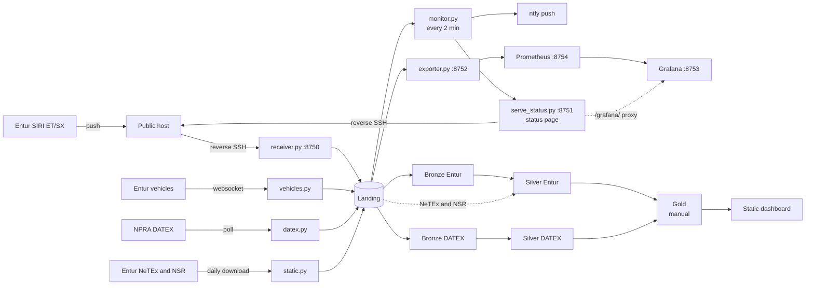

# Architecture

This page explains component boundaries, the landing contract and batch schedules on the UiS VM.

Up: [project](../../README.md) · Related: [runbook](../../collector/README.md),
[storage](storage.md), [overview](../report/overview.md)



All five application ports shown above bind to `127.0.0.1`. Only receiver and status ports cross the tunnel.
The [README](../../README.md) owns current deployment status.

## Components

| Component | Code | Boundary |
| --------- | ---- | -------- |
| SIRI | [receiver.py](../../collector/receiver.py) | ET/SX pushes |
| Vehicles | [vehicles.py](../../collector/vehicles.py) | National GraphQL subscription |
| DATEX | [datex.py](../../collector/datex.py) | One thread per feed |
| Static | [static.py](../../collector/static.py) | NeTEx/NSR daily, 04:15 UTC |
| Monitor | [monitor.py](../../collector/monitor.py) | Collection checks and status |
| Status | [serve_status.py](../../collector/serve_status.py) | Status and Grafana proxy |
| Metrics | [exporter.py](../../collector/exporter.py) | Landing metadata and state |

## Collectors

Collectors preserve payloads without domain parsing or filtering. SIRI heartbeats, repeated
snapshots and failed DATEX polls remain as coverage evidence. Vehicle protocol pings are
answered without being stored.

The [SIRI receiver](../../collector/receiver.py) renews subscriptions after 24 h or three
missed heartbeats. Retries are at least five minutes apart. The vehicle collector reconnects
with backoff and receives a full snapshot on each new subscription. Ruter supplies no
positions in this feed. See [subscription behaviour](../entur/realtime.md#pubsub-how-the-subscription-works).

The [DATEX poller](../../collector/datex.py) uses Basic Auth and stays idle without credentials.
See [DATEX sources](../datex/sources.md#feeds) for feeds, intervals and access terms.

The [static archive](../../collector/static.py) stores unchanged ZIPs and manifests.
It applies a **20-hour guard**, which does not enforce Entur's rolling 24-hour limit.
Never download these files by hand. See [Entur timetable exports](../entur/sources.md#timetable-netex-gtfs) for availability.

## Landing zone

Only collectors write here.

```text
/data/dat535/landing/
├── siri-et/date=YYYY-MM-DD/hour=HH.jsonl.gz
├── siri-sx/...
├── vehicles/...
├── datex-<feed>/...  situation, traveltime, weather, traveltime-locations, weather-sites
├── netex/date=YYYY-MM-DD/rb_norway-aggregated-netex.zip
└── nsr/date=YYYY-MM-DD/Current_latest.zip
```

| Source | JSON-line fields |
| ------ | ---------------- |
| SIRI, vehicles | `received_at`, `endpoint` (`et`, `sx`, `vehicles`), `payload` |
| DATEX | `requested_at`, `received_at`, `endpoint`, `http_status`, `last_modified`, `error`, `payload` |

`payload` is an XML or JSON string. DATEX uses null for failures and HTTP 304 responses.

[hourly.py](../../collector/hourly.py) appends to `hour=HH.jsonl.part`. After the hour closes,
it compresses through `.jsonl.gz.tmp` and atomically renames to `.jsonl.gz`. A restart adopts
the current `.part` and queues older ones for compression. Closed files are never overwritten.

- Dates and hours are UTC. At rotation boundaries, a delayed append stays in the open hour.
  Silver maps UTC partitions to Norwegian operating days.
- Readers accept only closed `hour=HH.jsonl.gz` and legacy `hour=HH.jsonl` files.
  The plain files are legacy hours closed before 2026-10-15. Never read `.part` or `.tmp` files.
- Static downloads use `.part` until ZIP validation succeeds. Each ZIP has a `.meta.json`
  recording URL, HTTP Last-Modified, ETag, size, SHA-256 and download times.
- Hourly JSON Lines keep messages separate. Gzip is not splittable, so each hour is one read task.
- Payloads exceed Jackson's default string cap. Use the JSON reader setting in [storage](storage.md#memory).
- Landing is immutable after closure. Cleanup is manual and follows the [storage order](storage.md#when-it-fills-delete-by-hand-cheapest-loss-first).

## Batch pipeline

Workflows use the self-hosted runner, `~/spark-env`, `/opt/spark` and Java 8.
Landing comes from `~/.config/dat535/collector.env`. Outputs go beside it in `prod/` or `dev/`.
Spark steps share the [storage lock](storage.md#memory).

| Trigger | Behaviour |
| ------- | --------- |
| Production push to `main` | Approval through environment `main`, both test suites, collector deployment |
| Production schedule or dispatch | Batch processing without deployment or test reruns |
| Dev push to any branch except `main`, or dispatch | Both test suites, then yesterday's 08:00–09:00 UTC sample |

The [production workflow](../../.github/workflows/dat535-prod.yml) schedules `0 3 * * *`.
Runs checked on 2026-11-11 started at about 09:20–10:50 UTC. Its steps run sequentially:

1. [Entur Bronze](../../pipeline/bronze.py) and [DATEX Bronze](../../pipeline/bronze_datex.py)
   ingest yesterday's UTC files. Payloads stay unchanged in zstd Parquet with provenance and run records.
   Reruns replace only the selected day.
2. [DATEX Silver](../../pipeline/silver_datex.py) processes yesterday's UTC observation day.
3. [Entur Silver](../../pipeline/silver.py) processes the operating day two days ago.
   ET reads three adjacent UTC days and the newest references archived on or before the operating day.
   SX and vehicles retain UTC grains.

DATEX Bronze is attempted even if Entur Bronze fails. Each Silver step depends on its own
Bronze step. A failure in the other source does not suppress it.

On dispatch, `bronze_date` selects both Bronze days. Setting it alone skips Silver.
`silver_date` selects both Silver dates, UTC for DATEX and Norwegian operating date for Entur.
Preceding Bronze steps still run. Missing days require manual reruns.

The [dev workflow](../../.github/workflows/dat535-dev.yml) has no PR trigger, so code from a fork
never reaches the runner. A PR branch in this repo gets its run from the push. Silver uses
yesterday and `--allow-partial`, leaving the sample not ready.
Both workflows upload Bronze and Silver run records. [Silver](../pipeline/silver.md#reading-safely) owns
publication and readiness contracts.

[Gold](../../pipeline/gold.py) runs by hand for an operating day once both its Entur Silver and
the same UTC day of DATEX Silver are ready. It publishes four tables, and
[dashboard/build.py](../../dashboard/build.py) packages chosen days as a static site. See
[what is built](../pipeline/gold-example.md#run-on-the-vm) and [evidence](../report/evidence/README.md).

## Monitoring

[monitor.py](../../collector/monitor.py) runs every two minutes and checks:

- Receiver process, SIRI and vehicle landing freshness and growth, with a default five-minute limit.
- DATEX process and login, successful polls and landing writes. The default limit is the larger
  of five minutes or two poll intervals plus 60 s. Unchanged snapshots fail after 30 min for
  travel time and 60 min for weather.
- NeTEx and NSR archive freshness, with a 30-hour limit.
- Data and root volumes against `MONITOR_DISK_MAX_PCT`, default 90 %.

Idle DATEX skips feed checks. The monitor sends ntfy.sh notifications on overall OK/FAIL
transitions, so additional failures while already unhealthy send no new alert.
The topic name is the secret. Batch failures are not covered. See the [status-page style](switchboard-style.md).

[exporter.py](../../collector/exporter.py) reads landing names and sizes, state files, monitor
results, disk and memory. [Prometheus](../../collector/observability/prometheus.yml) scrapes
every 30 s. Retention is limited to 365 days or 5 GB. Its localhost OTLP receiver is available
for future job metrics. Grafana's `DAT535 Collector` dashboard is provisioned from the repo
and available anonymously, read-only, through `/grafana/`.
Landing data, Prometheus and the exporter are not exposed by the tunnel.

## Operations

Actions checks out the repository on the VM. [deploy.sh](../../collector/deploy.sh) copies
collectors into their service installation. Setup, credentials, pinned monitoring tools and
selective restarts belong in the [runbook](../../collector/README.md#what-runs).

## Decisions

- `ET_CLIENT_NAME` defaults to `uis-dat535group21-collector`. It identifies Entur requests,
  SIRI requestor/subscriber and the DATEX User-Agent.
- DATEX credentials stay in the VM environment file. Requests use HTTPS and do not follow redirects.
- Silver parses XML inside Spark tasks with Python's `xml` package instead of `spark-xml`,
  because Spark 3.5 has no native `from_xml`.
- Layer outputs use `/data/dat535/{prod,dev}/<layer>/`. Memory and spill rules live in [storage](storage.md#memory).

The course template [pipeline.yml](../../.github/workflows/pipeline.yml) also declares manual
and monthly triggers, but its only job is disabled with `if: false`.

## Open decisions

See [evidence](../report/evidence/README.md) for full-day Silver measurements.
Spill and network-volume latency measurements should guide partition tuning.
Other products remain [Gold proposals](../pipeline/gold.md#at-a-glance).
